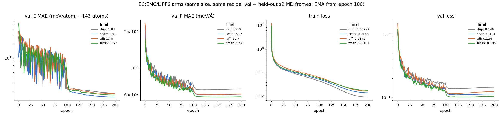

# Rigid-molecule volume scans for a LiPF6 / EC:EMC electrolyte: does the augmentation itself help?

## Motivation: an open, publicly available dataset and protocol

This experiment is motivated by an open study with public data:

> I.-B. Magdău, D. J. Arismendi-Arrieta, H. E. Smith, C. P. Grey, K. Hermansson, G. Csányi,
> **"Machine learning force fields for molecular liquids: Ethylene Carbonate/Ethyl Methyl Carbonate binary solvent"**,
> *npj Computational Materials* **9** (2023). DOI: [10.1038/s41524-023-01100-w](https://doi.org/10.1038/s41524-023-01100-w) (open access, CC BY 4.0).
> Data, training/test sets (incl. volume scans and intra/inter-molecular splits), GAP potential and MD trajectories:
> Zenodo [10.5281/zenodo.8043753](https://doi.org/10.5281/zenodo.8043753).

Two ideas from that paper drive this test:
1. **The scale separation.** Intermolecular forces are small next to intramolecular ones, so an overall force error says little about intermolecular quality.
2. **Rigid-molecule volume scans.** Rescale the box while keeping every molecule's internal geometry fixed, so only intermolecular distances change.

Our question is causal. **Do volume scans themselves improve the intermolecular part of an MLIP?** Or does any extra data of the same size do just as well, whether it's copies, naively scaled frames or fresh MD? The use case behind it is getting small energy differences right, e.g. Li⁺ binding to a carbonyl vs an ether oxygen. EMC is a hard case because its two oxygen types behave similarly.

## Setup
- **Teacher and student:**
  - Teacher: PET-MAD-m (pet-jax). It is PET-MAD-1.6: r²SCAN, 102 elements, trained on MAD-1.6 (Malosso et al., arXiv:2603.02089). There is no explicit long-range dispersion correction, so absolute densities are not the point; student vs teacher is.
  - Student: apax GMNN, r_max 5 Å, identity readout with zero-init output, energy + forces only, `energy_regularisation 1e-5`, Muon optimiser.
- **Boxes** (`scripts/build_mols.py`, `scripts/pack.py`): packmol with PBC, 135–151 atoms, cells 10.8–12.5 Å, at 1.10/1.20/1.30 g/cm³.
  - Main composition: 1 LiPF6 + 3 EC + 7 EMC, by molecule count.
  - Variants: no salt; 2 LiPF6; EC:EMC 4:6; one EMC→DMC; +LiF; +HF.
  - The variants make the composition matrix full rank (6 of 6 elements), so the per-element energy regression cannot collapse.
  - Every atom carries `mol_id`.
- **Teacher MD** (`scripts/teacher_md.py`): fast sampling for a dataset, not for physics.
  - H mass 4 amu, dt 2 fs, Langevin; 0.5 ps per box at 300/400/500 K; a frame every 20 fs.
  - Sets:
    - s1 packings → training base;
    - s2 packings → validation and test only;
    - "fresh": s1 packings with a new seed at T + 50 K.
- **Rigid-molecule scans** (`scripts/volume_scan.py`):
  - Each molecule is unwrapped along its bond graph, then the centres of mass and the cell are scaled by s ∈ {0.95, 1.05, 1.10}.
  - Internal geometry is verified preserved to 1e-8 Å.
  - `--affine` gives plain ASE scaling with `scale_atoms=True`, where every bond stretches too.

## The intervention (`scripts/make_arms.py`, `configs/arm_*.yaml`)
All arms have the same size and the same training recipe (200 epochs):

| arm | training set |
|---|---|
| `dup` | s1 MD + one unchanged copy of the source frame per scan (controls for dataset size and number of gradient steps) |
| `scan` | s1 MD + rigid-molecule volume scans of every 3rd frame |
| `aff` | s1 MD + affine (bond-stretching) scans of the same (frame, s) pairs |
| `fresh` | s1 MD + the same number of new teacher-MD frames (controls for "more teacher labels of any kind") |

**Test:** held-out s2 MD frames, plus rigid scans of the s2 frames.

**Metrics** (`scripts/eval_inter_intra.py`):
- Forces split per molecule into translational (net force), rotational (net torque, from α = I⁻¹τ) and intramolecular (the rest), as in Magdău et al.
- For each part and each molecule type (EC/EMC/DMC/PF6/Li/LiF/HF): RMSE and RMSE relative to the teacher's RMS.
- Per-atom energy error per scan factor.
- The decomposition is unit-tested: the parts sum to F; rigid-body forces give zero intramolecular part; forces with zero net force and torque give zero intermolecular part.

**Solvation observable** (`scripts/solvation.py`): Li⁺ first-shell counts, carbonyl O vs ether O per solvent and F per anion, for student vs teacher MD.

## Side finding: molify `compress(freeze_molecules=True)` needs unwrapped input
- **The problem:** it computes each molecule's centre of mass on wrapped coordinates. In small periodic boxes, a bond that crosses the boundary then changes by (1 − s)·L.
  - On a 143-atom frame, 12–13 of 188 bonds changed, by up to −0.55 Å at s = 0.95 and +1.15 Å at s = 1.10.
  - That is exactly the change in cell edge.
- **The workaround:** passing an unwrapped structure (e.g. via `molify.unwrap_structures`) makes it exact. Bond changes are then 1e-15 Å, and positions match our scan to 2e-6 Å.
- **Suggested fix:** unwrap inside `compress`.

## Results (2026-10-21, one seed per arm)

**Headline (v1, isotropic scans; anisotropic general-strain scans do better still, see §5).**
- **Rigid-molecule volume scans give the same intermolecular-force gain on held-out MD as new teacher MD of the same size, at about 1/18 of the teacher calls.**
- **They are the only augmentation that keeps the energy flat across density.**
- **Duplicating frames gives the lowest training loss and the worst test error. Bond-stretching (affine) scaling recovers only a third of the intermolecular gain.**

**Sizes.** Every arm has 441 s1 MD frames + 399 extra = 840 train frames, 200 epochs, the same recipe and seed.
- Validation: 48 held-out s2 MD frames.
- Test: 393 held-out s2 MD frames, plus 399 rigid scans of s2 frames.
- s2 packings and trajectories are never seen in training.

### 1. Held-out MD frames (393): force-component RMSE in meV/Å (change vs `dup`)

| arm | translational | rotational | intramolecular | Li⁺ (all translational) | E MAE (meV/atom) |
|---|---|---|---|---|---|
| `dup` | 36.4 | 18.5 | 102.3 | 372 | 2.47 |
| `scan` | 24.5 (**−33 %**) | 14.4 (**−22 %**) | 93.8 (−8 %) | 240 (**−35 %**) | 2.31 |
| `aff` | 32.5 (−11 %) | 17.6 (−5 %) | 93.2 (−9 %) | 337 (−9 %) | 2.67 |
| `fresh` | 22.7 (**−38 %**) | 14.5 (**−22 %**) | 90.4 (−12 %) | 216 (**−42 %**) | 2.09 |

Teacher RMS of each component over all atoms: translational 53, rotational 42, intramolecular 970 meV/Å.

### 2. Held-out rigid scans of s2 (399): intermolecular forces and energy vs density

| arm | translational | rotational | E MAE at s = 0.95 / 1.05 / 1.10 (meV/atom) |
|---|---|---|---|
| `dup` | 48.1 | 24.8 | 3.05 / 2.57 / 3.66 |
| `scan` | 25.2 (**−48 %**) | 15.7 (**−37 %**) | **2.84 / 2.16 / 2.30** (flat) |
| `aff` | 32.6 (−32 %) | 19.4 (−22 %) | 3.40 / 2.57 / 2.80 |
| `fresh` | 31.5 (−35 %) | 19.2 (−23 %) | 2.49 / 2.37 / 3.19 |

The scan test set favours the scan arm: it is the same kind of augmentation. What matters is that fresh MD does *not* buy this density transferability.

### 3. Validation learning curves (`figs/arms_loss.png`)

| arm | final train loss | val E MAE (meV/atom, ≈143 atoms) | val F MAE (meV/Å) |
|---|---|---|---|
| `dup` | **0.0098** (lowest) | 1.84 | 66.9 (worst) |
| `scan` | 0.0148 | **1.51** (−18 %) | 60.5 (−10 %) |
| `aff` | 0.0175 | 1.78 (−3 %) | 60.7 (−9 %) |
| `fresh` | 0.0187 | 1.67 (−9 %) | **57.6** (−14 %) |

`dup` memorises: it has the lowest training loss and the worst validation error. Validation loss creeps up slightly after epoch ~110 for every arm alike (mild overfitting at 200 epochs).

### 4. Cost: teacher calls per extra labelled frame

| arm | how the 399 extra frames were made | teacher calls | calls per frame | GPU wall time |
|---|---|---|---|---|
| `fresh` | 21 MD runs × (100 FIRE pre-relax + 250 MD steps); 441 frames, 399 used | ~7,350 | **~18** | ~25 min |
| `scan` | one call per rescaled frame, reusing MD frames already labelled for the base set | 399 | **1** | ~3 min |

- The ~18× already flatters fresh MD, because our sampling is aggressive: H mass 4 amu, dt 2 fs, a frame every 20 fs.
- With conventional settings (0.5 fs steps, a frame every ≥50 fs, plus equilibration), new MD costs 100+ teacher calls per frame. Scans would then be roughly 100× cheaper per frame for the same intermolecular gain.

### Reading
1. **Intermolecular forces are the weak part, as Magdău et al. found.** Relative RMSE on held-out MD is 0.08–0.10 for the intramolecular part, but 0.35–0.68 for the translational and 0.29–0.45 for the rotational parts. Li⁺ is at 0.50–0.86.
   - A small overall force error hides an intermolecular part that is barely learned. The overall error is dominated by the ~20× larger intramolecular component.
2. **New data goes mostly into the weak part.** The best arms cut intermolecular error by 22–38 % but intramolecular error by only 8–12 %.
3. **Rigid scans ≈ fresh MD on held-out MD frames, at ~1/18 of the labelling cost.** They beat fresh MD clearly off-equilibrium density, with a flat energy error to s = 1.10.
4. **Keeping molecules rigid matters.** Affine scaling of the same frames and factors gets about a third of the translational gain on MD frames (−11 % vs −33 %) and no energy gain. It spends the extra frames on correlated bond stretches the liquid never samples.
5. **Duplicates are not data.** Lowest training loss, worst test error: they buy fitting, not information.
6. **Scans multiply MD; they don't replace it.** They need source frames. The efficient recipe looks like a modest amount of MD plus several rigid scans per frame.

### Caveats
- **One seed per arm.** Differences of about 5 % (`scan` vs `fresh` on MD-frame forces, `scan` vs `aff` on intramolecular forces) are within plausible seed noise. The −33 to −48 % intermolecular gains and the `dup` overfitting are large compared with that.
- **Teacher:** PET-MAD-1.6-m (r²SCAN, MAD-1.6, no explicit long-range dispersion). This is a student-vs-teacher study, not a statement about real electrolyte physics.
- **Short, fast-sampled MD** (0.5 ps per box, H mass 4, from packmol starts). The frames are not equilibrated, which is fine for labelled training and test data. Solvation statistics, the downstream target, are not yet evaluated.
- **HF and LiF** have 1–2 molecules per box. Their per-type numbers are noise.
- The validation per-atom energies assume ≈143 atoms per frame (boxes are 135–151). The test tables use exact per-frame atom counts.

### Next
- **Cost-matched comparison at a fixed teacher-call budget,** e.g. 21 MD runs vs 7 runs + 3 rigid scans per frame, on the same s2 test, two seeds each.
- **A `fresh + scan` arm.**
- **Second seed for all four arms.**
- **Student MD vs teacher MD Li⁺ solvation,** carbonyl vs ether O per solvent (`scripts/solvation.py`), to check whether the intermolecular gains show up in the observable.
- **Ordering test:** energy differences between carbonyl- and ether-bound Li⁺ configurations (rigid swaps).

### Bugs hit along the way (kept for the record)
- `Atoms.copy()` drops the attached SinglePointCalculator. The first `dup` build had 399 unlabelled frames and crashed apax's shift statistics. Fixed by reusing the labelled source objects.
- packmol from Python needs a seekable stdin (a file, not a pipe).
- molify `compress(freeze_molecules=True)` needs unwrapped input (see above).

Raw evaluation output: `logs/arms_eval_raw.md`. Training logs: `logs/log_arm_*.csv`.
