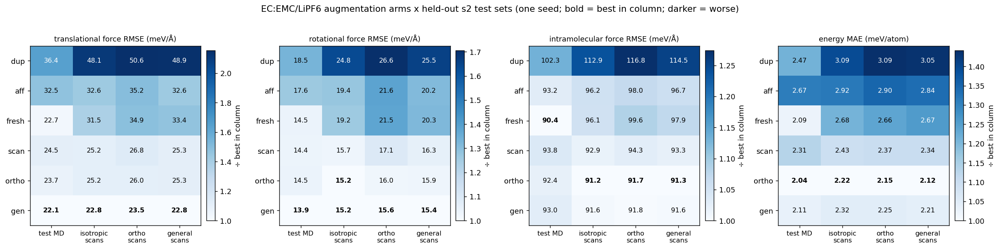
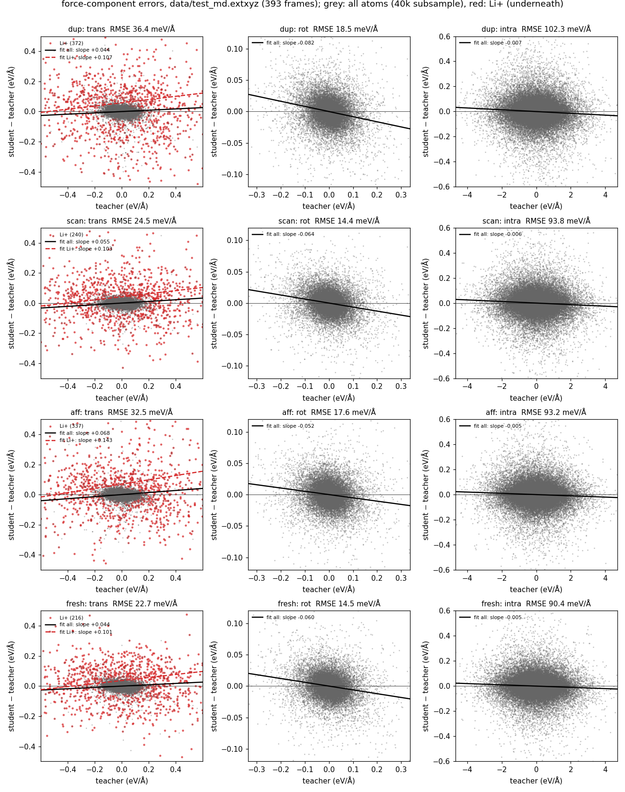
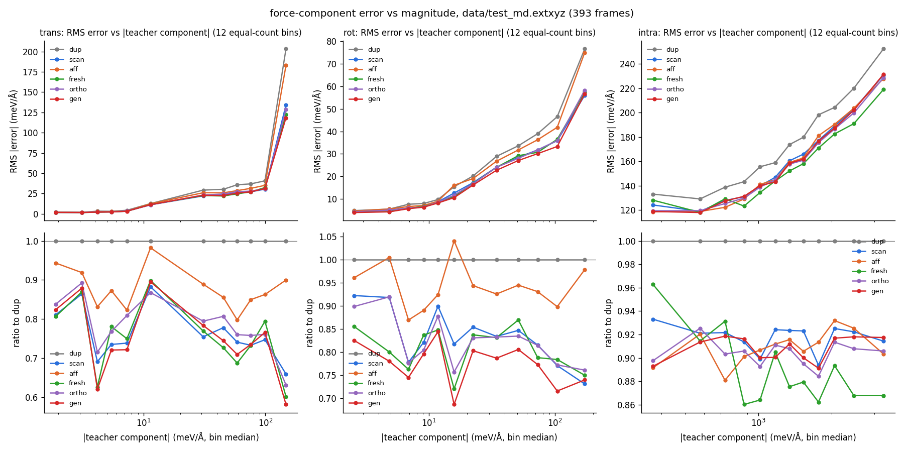

# Rigid-molecule volume scans for a LiPF6 / EC:EMC electrolyte: does the augmentation itself help?

## Motivation: an open, publicly available dataset and protocol

This experiment is motivated by an open study with public data:

> I.-B. Magdău, D. J. Arismendi-Arrieta, H. E. Smith, C. P. Grey, K. Hermansson, G. Csányi,
> **"Machine learning force fields for molecular liquids: Ethylene Carbonate/Ethyl Methyl Carbonate binary solvent"**,
> *npj Computational Materials* **9** (2023). DOI: [10.1038/s41524-023-01100-w](https://doi.org/10.1038/s41524-023-01100-w) (open access, CC BY 4.0).
> Data, training/test sets (incl. volume scans and intra/inter-molecular splits), GAP potential and MD trajectories:
> Zenodo [10.5281/zenodo.8043753](https://doi.org/10.5281/zenodo.8043753).

Two ideas from that paper drive this test:
1. **The scale separation.** Intermolecular forces are small next to intramolecular ones, so an overall force error says little about intermolecular quality.
2. **Rigid-molecule volume scans.** Rescale the box while keeping every molecule's internal geometry fixed, so only intermolecular distances change.

Our question is causal. **Do volume scans themselves improve the intermolecular part of an MLIP?** Or does any extra data of the same size do just as well, whether it's copies, naively scaled frames or fresh MD? The use case behind it is getting small energy differences right, e.g. Li⁺ binding to a carbonyl vs an ether oxygen. EMC is a hard case because its two oxygen types behave similarly.

## Setup
- **Teacher and student:**
  - Teacher: PET-MAD-m (pet-jax). It is PET-MAD-1.6: r²SCAN, 102 elements, trained on MAD-1.6 (Malosso et al., arXiv:2603.02089). There is no explicit long-range dispersion correction, so absolute densities are not the point; student vs teacher is.
  - Student: apax GMNN, r_max 5 Å, identity readout with zero-init output, energy + forces only, `energy_regularisation 1e-5`, Muon optimiser.
- **Boxes** (`scripts/build_mols.py`, `scripts/pack.py`): packmol with PBC, 135–151 atoms, cells 10.8–12.5 Å, at 1.10/1.20/1.30 g/cm³.
  - Main composition: 1 LiPF6 + 3 EC + 7 EMC, by molecule count.
  - Variants: no salt; 2 LiPF6; EC:EMC 4:6; one EMC→DMC; +LiF; +HF.
  - The variants make the composition matrix full rank (6 of 6 elements), so the per-element energy regression cannot collapse.
  - Every atom carries `mol_id`.
- **Teacher MD** (`scripts/teacher_md.py`): fast sampling for a dataset, not for physics.
  - H mass 4 amu, dt 2 fs, Langevin; 0.5 ps per box at 300/400/500 K; a frame every 20 fs.
  - Sets:
    - s1 packings → training base;
    - s2 packings → validation and test only;
    - "fresh": s1 packings with a new seed at T + 50 K.
- **Rigid-molecule scans** (`scripts/volume_scan.py`):
  - Each molecule is unwrapped along its bond graph, then the centres of mass and the cell are scaled by s ∈ {0.95, 1.05, 1.10}.
  - Internal geometry is verified preserved to 1e-8 Å.
  - `--affine` gives plain ASE scaling with `scale_atoms=True`, where every bond stretches too.

## The intervention (`scripts/make_arms.py`, `configs/arm_*.yaml`)
All arms have the same size and the same training recipe (200 epochs):

| arm | training set |
|---|---|
| `dup` | s1 MD + one unchanged copy of the source frame per scan (controls for dataset size and number of gradient steps) |
| `scan` | s1 MD + rigid-molecule volume scans of every 3rd frame |
| `aff` | s1 MD + affine (bond-stretching) scans of the same (frame, s) pairs |
| `fresh` | s1 MD + the same number of new teacher-MD frames (controls for "more teacher labels of any kind") |

**Test:** held-out s2 MD frames, plus rigid scans of the s2 frames.

**Metrics** (`scripts/eval_inter_intra.py`):
- Forces split per molecule into translational (net force), rotational (net torque, from α = I⁻¹τ) and intramolecular (the rest), as in Magdău et al.
- For each part and each molecule type (EC/EMC/DMC/PF6/Li/LiF/HF): RMSE and RMSE relative to the teacher's RMS.
- Per-atom energy error per scan factor.
- The decomposition is unit-tested: the parts sum to F; rigid-body forces give zero intramolecular part; forces with zero net force and torque give zero intermolecular part.

**Solvation observable** (`scripts/solvation.py`): Li⁺ first-shell counts, carbonyl O vs ether O per solvent and F per anion, for student vs teacher MD.

## Side finding: molify `compress(freeze_molecules=True)` needs unwrapped input
- **The problem:** it computes each molecule's centre of mass on wrapped coordinates. In small periodic boxes, a bond that crosses the boundary then changes by (1 − s)·L.
  - On a 143-atom frame, 12–13 of 188 bonds changed, by up to −0.55 Å at s = 0.95 and +1.15 Å at s = 1.10.
  - That is exactly the change in cell edge.
- **The workaround:** passing an unwrapped structure (e.g. via `molify.unwrap_structures`) makes it exact. Bond changes are then 1e-15 Å, and positions match our scan to 2e-6 Å.
- **Suggested fix:** unwrap inside `compress`.

## Results (2026-10-21, one seed per arm)

**Headline (v1, isotropic scans; anisotropic general-strain scans do better still, see §5).**
- **Rigid-molecule volume scans give the same intermolecular-force gain on held-out MD as new teacher MD of the same size, at about 1/18 of the teacher calls.**
- **They are the only augmentation that keeps the energy flat across density.**
- **Duplicating frames gives the lowest training loss and the worst test error. Bond-stretching (affine) scaling recovers only a third of the intermolecular gain.**

**Sizes.** Every arm has 441 s1 MD frames + 399 extra = 840 train frames, 200 epochs, the same recipe and seed.
- Validation: 48 held-out s2 MD frames.
- Test: 393 held-out s2 MD frames, plus 399 rigid scans of s2 frames.
- s2 packings and trajectories are never seen in training.

### 1. Held-out MD frames (393): force-component RMSE in meV/Å (change vs `dup`)

| arm | translational | rotational | intramolecular | Li⁺ (all translational) | E MAE (meV/atom) |
|---|---|---|---|---|---|
| `dup` | 36.4 | 18.5 | 102.3 | 372 | 2.47 |
| `scan` | 24.5 (**−33 %**) | 14.4 (**−22 %**) | 93.8 (−8 %) | 240 (**−35 %**) | 2.31 |
| `aff` | 32.5 (−11 %) | 17.6 (−5 %) | 93.2 (−9 %) | 337 (−9 %) | 2.67 |
| `fresh` | 22.7 (**−38 %**) | 14.5 (**−22 %**) | 90.4 (−12 %) | 216 (**−42 %**) | 2.09 |

Teacher RMS of each component over all atoms: translational 53, rotational 42, intramolecular 970 meV/Å.

### 2. Held-out rigid scans of s2 (399): intermolecular forces and energy vs density

| arm | translational | rotational | E MAE at s = 0.95 / 1.05 / 1.10 (meV/atom) |
|---|---|---|---|
| `dup` | 48.1 | 24.8 | 3.05 / 2.57 / 3.66 |
| `scan` | 25.2 (**−48 %**) | 15.7 (**−37 %**) | **2.84 / 2.16 / 2.30** (flat) |
| `aff` | 32.6 (−32 %) | 19.4 (−22 %) | 3.40 / 2.57 / 2.80 |
| `fresh` | 31.5 (−35 %) | 19.2 (−23 %) | 2.49 / 2.37 / 3.19 |

The scan test set favours the scan arm: it is the same kind of augmentation. What matters is that fresh MD does *not* buy this density transferability.

### 3. Validation learning curves (`figs/arms_loss.png`)

| arm | final train loss | val E MAE (meV/atom, ≈143 atoms) | val F MAE (meV/Å) |
|---|---|---|---|
| `dup` | **0.0098** (lowest) | 1.84 | 66.9 (worst) |
| `scan` | 0.0148 | **1.51** (−18 %) | 60.5 (−10 %) |
| `aff` | 0.0175 | 1.78 (−3 %) | 60.7 (−9 %) |
| `fresh` | 0.0187 | 1.67 (−9 %) | **57.6** (−14 %) |

`dup` memorises: it has the lowest training loss and the worst validation error. Validation loss creeps up slightly after epoch ~110 for every arm alike (mild overfitting at 200 epochs).

### 4. Cost: teacher calls per extra labelled frame

| arm | how the 399 extra frames were made | teacher calls | calls per frame | GPU wall time |
|---|---|---|---|---|
| `fresh` | 21 MD runs × (100 FIRE pre-relax + 250 MD steps); 441 frames, 399 used | ~7,350 | **~18** | ~25 min |
| `scan` | one call per rescaled frame, reusing MD frames already labelled for the base set | 399 | **1** | ~3 min |

- The ~18× already flatters fresh MD, because our sampling is aggressive: H mass 4 amu, dt 2 fs, a frame every 20 fs.
- With conventional settings (0.5 fs steps, a frame every ≥50 fs, plus equilibration), new MD costs 100+ teacher calls per frame. Scans would then be roughly 100× cheaper per frame for the same intermolecular gain.

### Reading
1. **Intermolecular forces are the weak part, as Magdău et al. found.** Relative RMSE on held-out MD is 0.08–0.10 for the intramolecular part, but 0.35–0.68 for the translational and 0.29–0.45 for the rotational parts. Li⁺ is at 0.50–0.86.
   - A small overall force error hides an intermolecular part that is barely learned. The overall error is dominated by the ~20× larger intramolecular component.
2. **New data goes mostly into the weak part.** The best arms cut intermolecular error by 22–38 % but intramolecular error by only 8–12 %.
3. **Rigid scans ≈ fresh MD on held-out MD frames, at ~1/18 of the labelling cost.** They beat fresh MD clearly off-equilibrium density, with a flat energy error to s = 1.10.
4. **Keeping molecules rigid matters.** Affine scaling of the same frames and factors gets about a third of the translational gain on MD frames (−11 % vs −33 %) and no energy gain. It spends the extra frames on correlated bond stretches the liquid never samples.
5. **Duplicates are not data.** Lowest training loss, worst test error: they buy fitting, not information.
6. **Scans multiply MD; they don't replace it.** They need source frames. The efficient recipe looks like a modest amount of MD plus several rigid scans per frame.

### Caveats
- **One seed per arm.** Differences of about 5 % (`scan` vs `fresh` on MD-frame forces, `scan` vs `aff` on intramolecular forces) are within plausible seed noise. The −33 to −48 % intermolecular gains and the `dup` overfitting are large compared with that.
- **Teacher:** PET-MAD-1.6-m (r²SCAN, MAD-1.6, no explicit long-range dispersion). This is a student-vs-teacher study, not a statement about real electrolyte physics.
- **Short, fast-sampled MD** (0.5 ps per box, H mass 4, from packmol starts). The frames are not equilibrated, which is fine for labelled training and test data. Solvation statistics, the downstream target, are not yet evaluated.
- **HF and LiF** have 1–2 molecules per box. Their per-type numbers are noise.
- The validation per-atom energies assume ≈143 atoms per frame (boxes are 135–151). The test tables use exact per-frame atom counts.

### 5. Anisotropic rigid scans: orthorhombic vs general strain (2026-10-22)
Two more arms, each dose-matched to `scan`:
- the same source frames;
- the same s values with the same per-s counts (106 / 146 / 147);
- the same volume change, det U = s³.

Centres of mass and cell move by U = expm(ln s · I + D), where D is traceless with Frobenius norm fixed at 0.06 (about ±3.5 % per direction). Molecules stay rigid. The arms differ only in D (`scripts/volume_scan.py --aniso 0.06 --aniso_mode ...`):
- **`ortho`:** D diagonal (stretch only), so the cell stays orthorhombic.
- **`gen`:** D a general symmetric matrix (stretch + shear), so the cell becomes triclinic.

Each also has its own held-out s2 test set (`scripts/crossed_eval.sh`; raw output in `logs/eval/`).

`figs/crossed_heatmap.png`: one panel per metric; colour = value ÷ best in that test column (white = best, darker = worse); cell text = absolute value (`scripts/plot_crossed_heatmap.py`).

**Crossed evaluation, all atoms.** Each cell is translational / rotational / intramolecular force RMSE (meV/Å) / E MAE (meV/atom; for scan-type sets, the mean over s). Bold marks the best value in each column.

| arm \ test | MD (393) | isotropic scan (399) | ortho scan | general scan |
|---|---|---|---|---|
| `dup` | 36.4 / 18.5 / 102.3 / 2.47 | 48.1 / 24.8 / 112.9 / 3.09 | 50.6 / 26.6 / 116.8 / 3.09 | 48.9 / 25.5 / 114.5 / 3.05 |
| `scan` | 24.5 / 14.4 / 93.8 / 2.31 | 25.2 / 15.7 / 92.9 / 2.43 | 26.8 / 17.1 / 94.3 / 2.37 | 25.3 / 16.3 / 93.3 / 2.34 |
| `aff` | 32.5 / 17.6 / 93.2 / 2.67 | 32.6 / 19.4 / 96.2 / 2.92 | 35.2 / 21.6 / 98.0 / 2.90 | 32.6 / 20.2 / 96.7 / 2.84 |
| `fresh` | 22.7 / 14.5 / **90.4** / 2.09 | 31.5 / 19.2 / 96.1 / 2.68 | 34.9 / 21.5 / 99.6 / 2.66 | 33.4 / 20.3 / 97.9 / 2.67 |
| `ortho` | 23.7 / 14.5 / 92.4 / **2.04** | 25.2 / **15.2** / **91.2** / **2.22** | 26.0 / 16.0 / **91.7** / **2.15** | 25.3 / 15.9 / **91.3** / **2.12** |
| `gen` | **22.1** / **13.9** / 93.0 / 2.11 | **22.8** / **15.2** / 91.6 / 2.32 | **23.5** / **15.6** / 91.8 / 2.25 | **22.8** / **15.4** / 91.6 / 2.21 |

**Reading:**
- **General strain has the lowest intermolecular force error on every test set.** On held-out MD it edges out `fresh`: 22.1 vs 22.7 translational, 13.9 vs 14.5 rotational, at about 1/18 of the teacher calls. That's −39 % translational vs `dup`. On `scan`'s own isotropic test it beats `scan` (22.8 vs 25.2).
- **Orthorhombic strain gives the best energies** on all four test sets (2.04–2.22 meV/atom), with the flattest scan-energy curves.
- **Isotropic and anisotropic training transfer to each other's tests.** Each is ~5–10 % better on its own kind; anisotropy is the better bet overall.
- **`fresh` MD does not transfer off equilibrium:** 31–35 translational on every scan-type test, vs 23–27 for any rigid-scan arm.
- **One seed per arm.** Gaps of ~5–10 % between the scan arms need the second seeds.
- **Superseded by the two-seed results in §7.** The `ortho`-best-energy claim and the `gen`-beats-`fresh`-on-MD claim did not survive.

### 6. Error structure (held-out MD)

**Least-squares slope of error vs teacher component** (student ≈ (1 + slope) × teacher; `figs/err_components_md.png`):

| arm | translational, all | translational, Li⁺ | rotational | intramolecular |
|---|---|---|---|---|
| `dup` | +0.044 | +0.107 | −0.082 | −0.007 |
| `scan` | +0.055 | +0.103 | −0.064 | −0.006 |
| `aff` | +0.068 | +0.143 | −0.052 | −0.005 |
| `fresh` | +0.044 | +0.101 | −0.060 | −0.005 |

- **Rotational slopes are negative.** That is ordinary regression to the mean of an MSE-optimal (conditional-mean) predictor with residual variance: the slope against the target is ≈ −Var(ε)/Var(y). Extra data reduces it.
- **Translational slopes are positive, which shrinkage cannot produce.** It is a systematic overestimate of net forces on molecules: ~5 % for the solvent and **10–14 % for Li⁺**. The Li⁺–environment interaction is effectively too stiff. The augmentations reduce variance, not this bias.

**Error vs component magnitude** (12 equal-count bins; `figs/err_vs_mag_md.png`):
- Translational error is flat up to ~100 meV/Å, then jumps to 120–200 meV/Å in the top bin, which is mostly Li⁺ and other ions. `gen` cuts that bin the most (0.58× `dup`).
- Rotational error grows steadily with magnitude. `gen` is lowest in most bins (0.69–0.80×).
- Intramolecular error: `fresh` is best at large forces (0.86×), the scan arms ~0.9×.

Plain parity plots: `figs/parity_components_md.png`.

### 7. Two seeds per arm, and the pairwise energy-difference loss (2026-10-22)

**Pairwise loss (`pairwise_mse`, added to `apax/train/loss.py`; upstream in `model-and-perf-improvements` as `d8787dc9`).**
- d_i is the per-atom energy error of structure i in a batch. The term is the mean over all batch pairs of (d_i − d_j)².
- That equals 2N/(N−1) × the within-batch variance of d, so a batch-common error offset is invisible to it.
- It is added on top of the normal energy MSE with weight λ = 150, `atoms_exponent: 0`. That is about 3.8× extra weight on within-batch error spread.
- Two batching variants:
  - `genroll`: random batches.
  - `genroll_pbp`: pbp batching with size buckets of ratio 1.1. pbp buckets by neighbour-pair count, which in these liquids groups frames of similar density.
- Both use the `gen` training data.

Held-out s2 data, mean of seeds 1 and 2 (seed 1 / seed 2 in brackets). Forces in meV/Å, E in meV/atom:

| arm | test MD trans | rot | intra | E | general-scan trans | rot |
|---|---|---|---|---|---|---|
| `scan` | 21.6 (24.5 / 18.8) | 14.3 | 95.2 | 2.19 (2.31 / 2.07) | 23.1 (25.3 / 20.8) | 16.5 |
| `fresh` | 22.4 (22.7 / 22.0) | 15.2 | **89.7** | 2.13 (2.09 / 2.17) | 31.7 (33.4 / 30.0) | 21.1 |
| `ortho` | 21.9 (23.7 / 20.1) | 14.6 | 94.6 | 1.92 (2.04 / 1.80) | 23.6 (25.3 / 21.9) | 16.3 |
| `gen` | 20.4 (22.1 / 18.6) | 13.9 | 94.8 | 2.09 (2.11 / 2.07) | 21.8 (22.8 / 20.8) | 15.6 |
| `genroll` | 20.4 (21.3 / 19.4) | 14.5 | 94.2 | 1.85 (1.88 / 1.83) | 21.0 (20.8 / 21.1) | 15.4 |
| `genroll_pbp` | **19.6** (20.1 / 19.0) | **13.4** | 93.0 | **1.85** (1.82 / 1.89) | **20.8** (21.0 / 20.6) | **14.6** |

**Reading:**
- **Seed noise is large.** One seed can move test-MD translational error by ±3 meV/Å (`scan`: 24.5 vs 18.8), and validation energy by ~25 %. Differences among `scan` / `ortho` / `gen` / `fresh` on MD-frame forces are within it.
- **What survives two seeds:**
  - Rigid scans beat fresh MD off equilibrium (general-scan translational 21–24 vs 31.7; rotational 15–16.5 vs 21.1).
  - Fresh MD is best on intramolecular forces (89.7 vs 93–95).
- **The pairwise loss is the first energy effect consistent across seeds.**
  - Test-MD E is 1.85 for both `genroll` and `genroll_pbp`, with all four individual seeds at 1.82–1.89, against 2.09 for `gen` (2.11 / 2.07): **−11 %**.
  - Force errors do not get worse; `genroll_pbp` has the lowest translational and rotational errors in both seeds.
  - This comes despite the pairwise term being ~1e-4 of the loss at the end of training (§ on loss shares). So treat it as promising, not settled: λ, batch-size and batch-composition sweeps with 3–4 seeds are queued to stress-test it.
- **`mix`** (50/50 `ortho` + `gen` scans, dose-matched, seed 1) lands between its parents (test MD 23.4 / 14.1 / 94.9, E 2.16). There is no sign that the strain types add up.

### 8. Energy-weighting arms (2026-10-22, one seed each)

Do the energies get better if we simply weight them more? Four arms on the `gen` data, all compared against the same `gen` seed (`configs/arm_gen_{cont,estage,estage_roll,ew100}.yaml`, `scripts/job_ew.sh`):
- `gen_cont`: `gen` plus 50 more epochs at the same weights. This is the control for the extra epochs.
- `gen_estage`: plus 50 epochs with the energy weight ×300, like MACE's stage two.
- `gen_estage_roll`: the same plus the pairwise loss at λ = 3e3.
- `gen_ew100`: energy weight ×100 from the start.

Test MD (forces meV/Å, E meV/atom):

| arm | trans | rot | intra | E | vs `gen` E |
|---|---|---|---|---|---|
| `gen` (200 epochs) | 22.1 | 13.9 | 93.0 | 2.11 | — |
| `gen_cont` (+50) | **21.2** | **13.8** | 93.6 | **1.99** | −6 % |
| `gen_estage` (+50, E ×300) | 23.0 | 14.5 | 100.5 | 2.15 | +2 % |
| `gen_estage_roll` (+ pairwise 3e3) | 23.0 | 14.5 | 100.4 | 2.16 | +2 % |
| `gen_ew100` (E ×100 throughout) | 35.1 | 21.7 | 129.3 | 2.73 | +29 % |

- **Weighting energies up makes everything worse,** forces and energies both. Each frame carries 3N ≈ 430 force labels against one energy, and the forces are energy gradients, so moving weight onto the single number throws away the denser signal. Muon follows only the direction of the summed gradient, which makes a dominant term take over completely.
- **The pairwise term does nothing under a ×300 energy weight:** it is swamped.
- **The +50-epoch control is slightly better than `gen`,** so fixed-epoch comparisons should match total epochs.

Figure: `figs/err_components_ew.png`.

### 9. Stress tests: strain size, strain type, and new test sets (2026-10-23)

**New held-out test sets** (all from s2 MD, teacher-labelled; `scripts/job_stress_data.sh`, `scripts/swap_pairs.py`):
- `shear`: general strain at norm 0.08, volume unchanged.
- `uniax`: orthorhombic strain at norm 0.15, volume unchanged.
- `o12`, `g12`, `o20`, `g20`: scans at those norms.
- `shift`: new teacher MD at 1.00 / 1.40 g/cm³ and 300 / 600 K.
- `x2`: 286-atom boxes at 300 / 450 K.
- `swapall` / `swapemc`: carbonyl↔ether rigid swaps of the solvent bound to Li⁺, for energy-difference ordering (see §12).

**Arms:** strain norm 0.03 / 0.06 / 0.12 / 0.20 × orthorhombic or general, 4 seeds each. All are dose-matched: 441 MD frames plus 399 scan frames with the isotropic `scan` arm's per-scale counts (`scripts/make_strain_arms.py`). `fresh` and `scan` have 2 seeds. Seed means below; full tables in `logs/strain_ladder_summary.md`, raw output in `logs/eval/`.

| metric (forces meV/Å, E meV/atom, swap ΔE meV) | fresh | g03 | gen (0.06) | g12 | **g20** | g20 vs fresh | g20 vs g12 |
|---|---|---|---|---|---|---|---|
| test MD trans | 22.4 | 20.9 | 19.7 | 19.1 | **18.0** | −20 % | −6 % |
| test MD intra | 89.7 | 95.2 | 93.9 | 92.2 | **86.9** | −3 % | −6 % |
| test MD E | 2.13 | 2.09 | 2.00 | 1.92 | **1.61** | −24 % | −16 % |
| uniax trans | 44.1 | 33.1 | 30.1 | 23.5 | **21.3** | −52 % | −9 % |
| shear trans | 26.2 | 21.8 | 20.4 | 19.4 | **18.5** | −29 % | −5 % |
| shift E | 1.42 | 1.34 | 1.50 | 1.49 | **0.96** | −32 % | −36 % |
| x2 E | 1.77 | 2.12 | 2.18 | 1.84 | **1.45** | −18 % | −21 % |
| swap ΔE, all | 309 | 280 | 254 | 193 | **159** | −49 % | −18 % |
| swap ΔE, EMC/DMC (Kendall τ) | 1219 (0.75) | 980 (0.82) | 911 (0.85) | 696 (0.90) | **502 (0.92)** | −59 % | −28 % |

The orthorhombic ladder follows the same trend: test MD trans 21.9 / 20.5 / 21.0 / 18.2; uniax trans 33.8 / 30.4 / 26.8 / 22.8.

**Reading:**
- **Strain size is the main knob, and there is no turnover yet.**
  - Errors fall from 0.03 to 0.20 on every test set, including unstrained MD and the swap pairs.
  - At 0.20 the rigid scans beat fresh MD even on intramolecular forces (86.9 vs 89.7), which no smaller strain did.
- **Larger strain acts as a regulariser** (`figs/loss_strain_ladder.png`).
  - Final training loss rises with strain: g03 0.0146, gen 0.0154, g12 0.0173, g20 0.0207.
  - Validation loss falls: 0.117, 0.107, 0.102, 0.091.
  - g03's validation loss creeps up after epoch 125.
- **General vs orthorhombic** (same-seed differences, gen − ortho, mean ± sd over 4 seeds):
  - At 0.03: nothing.
  - At 0.06 and 0.12: general is ~1–3 meV/Å better on translational force. The sign is consistent but only 1–2 sd (uniax at 0.12: −3.25 ± 1.55).
  - At 0.20: translational is equal, and general is better on intramolecular force by ~4 meV/Å on every test set (MD: −4.05 ± 0.33).
  - So general ≥ orthorhombic, but strain size matters far more than strain type.
- **Confound at 0.20: source-frame diversity.**
  - At 0.20 most compressed frames fail the 1.5 Å contact check (5–7 % survive). The pools were oversampled: every 2nd MD frame, plus an extra compressed-only pass with 6 strains per frame.
  - As a result, the 399 g20/o20 scan frames come from **236 / 229 distinct MD frames, vs 147** for every arm at ≤ 0.12.
  - The surviving compressed frames are also a selected subset: strain directions that happen to avoid close contacts.
  - A g12/o12 rebuilt from the same oversampled source set is the control that separates strain size from diversity. Not run yet.

**Error structure** (`figs/err_stress_uniax.png`, `figs/err_stress_md.png`; seed 1, error vs teacher value, slope of the linear fit):

| arm (uniax test) | trans RMSE / slope | rot RMSE / slope | Li⁺ trans slope |
|---|---|---|---|
| fresh | 37.8 / −0.139 | 33.4 / −0.193 | −0.005 |
| gen | 30.4 / −0.068 | 25.1 / −0.118 | +0.044 |
| g12 | **25.6 / −0.045** | **18.7 / −0.067** | −0.003 |
| gen, λ = 1e3 | 29.2 / −0.074 | 23.5 / −0.102 | +0.010 |

- Shrinkage toward the mean falls with strain size. That is consistent with slope = −Var(ε)/Var(y): larger strains widen the target range and reduce the error at the same time.
- The Li⁺ "too stiff" slope seen with `gen` vanishes at 0.12. Intramolecular errors show no structure for any arm (slope ≈ −0.01).

**A mechanism to test.**
- Intramolecular forces are ~1 eV/Å, against ~50–70 meV/Å for the translational and rotational parts. The intermolecular part is therefore ~0.5 % of the force MSE.
- Compressive strain pushes contacts into the repulsive wall, which makes intermolecular forces large and raises their share of the loss. It also pins the curvature of the intermolecular PES.
- The test: up-weight the translational and rotational components in the loss with no extra strain.

### 10. Pairwise energy-difference loss under stress (2026-10-23)

**λ sweep** (random batches of 4, `gen` data; 3 seeds, λ = 0 has 4):

| λ | test MD E | shift E | x2 E | test MD trans / intra | x2 trans | swap ΔE (all) | scan-family ΔE |
|---|---|---|---|---|---|---|---|
| 0 | 2.00 | 1.50 | 2.18 | 19.7 / 93.9 | 15.9 | 254 | 1.13 |
| 150 | 1.81 (−10 %) | 1.15 (−23 %) | 1.56 (−28 %) | 19.6 / 94.1 | 16.5 | 266 | 1.04 |
| **1e3** | **1.64 (−18 %)** | **0.78 (−48 %)** | **1.19 (−45 %)** | 20.6 / 93.7 | 18.1 | 270 | **0.99** |
| 3e3 | 1.94 | 1.11 | 1.31 | 20.3 / 97.8 | 19.8 | 321 | 1.04 |
| 1e4 | 1.97 | 0.98 | 1.84 | 22.6 / 103.6 | 22.3 | 328 | 1.08 |

- **λ = 1e3 is the sweet spot.** Energies improve most where the model extrapolates (composition/temperature shift, 2× boxes). The force cost is small on test MD (+5 % translational) and larger on x2 (+14 % translational). Above 1e3, forces degrade.
- **Validation (MD + scan frames from the training distribution) did not see any of this:** val E at λ = 1e3 equals λ = 0. Judge this loss on held-out shifted data only.
- **It does not help the carbonyl↔ether swap ΔE** (270 vs 254 meV), so it is not a fix for the ordering problem by itself.

**Batch size** (2 seeds, λ = 0 / 3e3; fixed 200 epochs):
- Batches of 8 and 16 are much worse on forces: test MD trans 31–32 vs 19.7, intra 104–114 vs 94. This is confounded by 2–4× fewer optimiser steps.
- λ = 3e3 does lower energies at larger batches: test MD E 2.62 → 1.94 at bs 8 and 2.49 → 1.99 at bs 16. More pairs per batch give the term more to work with.

**Batch composition** (pbp batching, 2 seeds; test MD trans / rot / intra / E):

| batching | trans | rot | intra | E |
|---|---|---|---|---|
| bucket by pair count (density), λ = 0 | 20.9 | 14.0 | 93.3 | 1.96 |
| bucket by pair count, λ = 150 (`genroll_pbp`) | 19.6 | 13.4 | 93.0 | 1.85 |
| bucket by atom count (composition), λ = 0 | 22.9 | 14.4 | 93.4 | 2.24 |
| bucket by atom count, λ = 3e3 | 20.9 | 13.9 | 95.5 | 1.83 |

- **No batching mode beats random batches.** pbp is ~3× slower per epoch (no scanned epoch).
- `bucket_by: atoms` is a new option in the apax worktree, not upstream.

The loss itself is upstream in apax `model-and-perf-improvements` (`d8787dc9`, `"pairwise_mse"`, with a test).

### 11. Cutoff and tensor channels: 2 × 2 (2026-10-23)

`r_max` 5 / 6 Å × `n_radial_tensor` 5 / 6, for `fresh`, `scan`, `gen`, `genroll`, 2 seeds each (`scripts/job_r6.sh`, `scripts/job_rx.sh`). The table averages over the four arms (variant = cutoff / tensor channels); full tables in `logs/cutoff_tensor_summary.md`.

| metric | 5 / 5 | 5 / 6 | 6 / 5 | 6 / 6 |
|---|---|---|---|---|
| test MD trans | 21.2 | 21.5 (+1 %) | **19.1 (−10 %)** | 19.2 (−9 %) |
| test MD intra | 93.5 | 93.7 (0 %) | 91.5 (−2 %) | **89.5 (−4 %)** |
| test MD E | 2.07 | 2.09 (+1 %) | **2.03 (−2 %)** | 2.12 (+2 %) |
| uniax trans | 35.6 | 36.2 (+2 %) | 31.3 (−12 %) | **31.1 (−13 %)** |
| swap ΔE (all) | 276 | 265 (−4 %) | 235 (−15 %) | **227 (−18 %)** |
| shift E | 1.39 | 1.62 (+17 %) | **1.07 (−23 %)** | 1.22 (−12 %) |

- **The 6 Å cutoff does the work.** The extra tensor channel does nothing at 5 Å.
- **At 6 Å the extra tensor channel buys ~2 % on intramolecular force but costs energy** (+14 % shift E vs 6 / 5). Training loss drops 21–28 % with it, so it is extra capacity that overfits energies (`figs/loss_cutoff_tensor.png`).
- **Best single model: `genroll` at 6 / 5:** test MD E 1.73, x2 E 1.15 (vs 1.74 at 5 / 5), uniax trans 28.1.
- **Scans still beat fresh off equilibrium at 6 Å** (uniax trans 28.9 vs 36.1). On equilibrium MD, fresh at 6 / 5 has the lowest translational error (18.2).
- **Recommended default:** `r_max` 6, `n_radial_tensor` 5, plus the pairwise loss. Cost is ~+20 % per epoch (1.1 vs 0.9 s).

### 12. The swap test set is too easy

- The rigid carbonyl↔ether swaps change the teacher energy by **1.8 eV on average (3.4 eV for EMC/DMC)**. Every model gets the sign right on every pair.
- They still rank models, through ΔE error and Kendall τ, but they do not test the small differences between binding modes that motivated this study.
- A real ordering test needs teacher-relaxed swap pairs, or pairs selected for |ΔE| below ~50 meV.

### Next
- **Strain size vs source-frame diversity:** g12 / o12 built from the oversampled 0.20 source set (~230 MD frames), 4 seeds.
- **Push the strain further:** 0.30, to find the turnover.
- **Combine the winners:** g20 + λ = 1e3 at `r_max` 6 / `n_radial_tensor` 5.
- **Loss-share mechanism:** a force loss with up-weighted translational and rotational components, without extra strain.
- **Batch size at matched optimiser steps.**
- **A small-ΔE ordering test set:** relaxed carbonyl / ether Li⁺ pairs.
- **Student MD vs teacher MD Li⁺ solvation** (`scripts/solvation.py`).

### Bugs hit along the way (kept for the record)
- `Atoms.copy()` drops the attached SinglePointCalculator. The first `dup` build had 399 unlabelled frames and crashed apax's shift statistics. Fixed by reusing the labelled source objects.
- packmol from Python needs a seekable stdin (a file, not a pipe).
- molify `compress(freeze_molecules=True)` needs unwrapped input (see above).
- **Silent eval failure:**
  - `eval_model.sh` ran `$P script.py` with `P` a bash array, which expands to its first element only (`taskset`). It also piped the output through `grep -v warn`, which hid the exit code.
  - All 61 evals "succeeded" while running nothing.
  - Fixed with `"${P[@]}"`, and the script now checks each log for its result table and exits non-zero if it is missing.
  - Queued batches are now watched by `scripts/qwatch.py`, which exits on the first failure, on completion, or when overdue.
- **Short scan pools:** at 0.12 the contact rejection left one scale's pool 3 frames short. `make_strain_arms.py` now tops up with repeats (≤ 3 of 399) and reports it.
- **pueue daemon in an agent shell's process group:** a low-memory reaper killed that group and took the daemon down mid-run. Start it with `setsid -f pueued -d`.

Raw evaluation output: `logs/arms_eval_raw.md`, `logs/eval/` (one file per model × test set). Summaries: `logs/strain_ladder_summary.md`, `logs/stress_summary.md`, `logs/cutoff_tensor_summary.md`. Training logs: `logs/log_arm_*.csv`.
