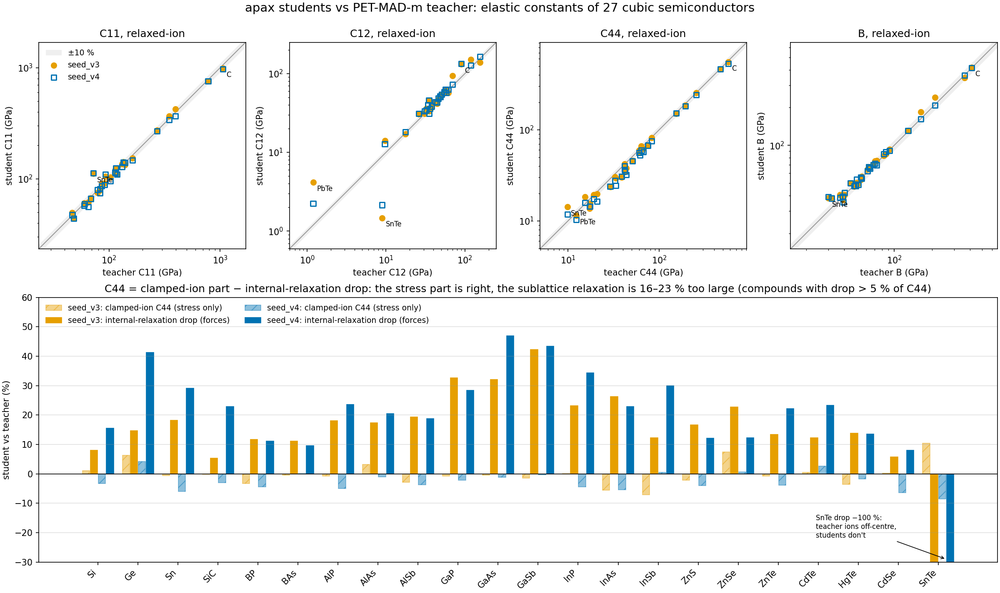

> **Note:** this study was carried out with Claude (Anthropic's AI assistant) under close human oversight.
> None of the conclusions here are final.

# Elastic constants (and phonons, pending) of apax students vs their PET-MAD-m teacher

Do students distilled from a foundation model reproduce the teacher's second derivatives (elastic constants and phonons)?
They were trained on energy, forces and stress, not on derivatives. The test set is 27 cubic tier-1 semiconductors (diamond, zincblende, rocksalt) from the
`semicond_dataset` project: one 20-element apax GMNN for all of them, plus the PET-MAD-m (r2SCAN, v1.6) teacher it was distilled from.

## Method (`scripts/elastic.py`)
- Each model relaxes its own lattice constant (hydrostatic `FrechetCellFilter`, BFGS fmax 1e-4 eV/Å) in the 8-atom conventional cell.
- Six Voigt strains × (−1, −0.5, +0.5, +1 %). Stress-strain slope → 6×6 C, then cubic averages C11, C12, C44, B = (C11+2C12)/3.
- **Relaxed-ion** (ions re-relaxed at fixed strained cell) and **clamped-ion** (no re-relaxation) values. Their difference isolates the
  internal-strain (Kleinman) contribution, which comes from the forces (the optical sublattice stiffness), not from the stress.
- Self-test: EMT Cu gives 172.6 / 115.5 / 89.9 GPa (EMT literature 176 / 116.5 / 90.6).
- Students: `seed_v3` (4292 frames) and `seed_v4`, apax branch `shallow-ensemble-uq`, final-epoch checkpoints.
  The scripts include a CPU-restore shim for GPU-saved orbax checkpoints.
- Teacher on CPU (pet-jax, 8 threads): ~45 s per material. Students: ~10 s.

## Results: relaxed-ion, student vs teacher (full tables in `semi_compare.md`)

| model | a₀ | C11 | C12 | C44 | B | Born-stable |
|---|---|---|---|---|---|---|
| seed_v3 median \|Δ\| | ≤ 0.1 % (SnTe −0.6 %) | 5.1 % | 3.4 GPa | 7.5 % | 4.0 % | 27/27 |
| seed_v4 median \|Δ\| | ≤ 0.13 % (SnTe −0.6 %) | 3.9 % | 3.0 GPa | 12.9 % | 2.5 % | 27/27 |

C12 is given in GPa because rocksalt C12 is ~1–18 GPa, where percentages blow up (PbTe teacher 1.2 GPa).

## Insight 1: C44 errors come from the forces, not the stress (`c44_split.md`)
| model | clamped-ion C44 median Δ | relaxed-ion C44 median Δ | internal-relaxation drop (clamped − relaxed), median Δ vs teacher |
|---|---|---|---|
| seed_v3 | −0.7 % | −7.1 % | **+16 %** (22 compounds) |
| seed_v4 | −3.2 % | −12.2 % | **+23 %** |

The pure-stress response (clamped) is close to exact. Under shear, the students' sublattices relax 16–23 % too far,
which means the restoring force for one sublattice against the other (the Γ optical mode) is too soft.
seed_v4 traded better B and C11 for worse C44.

## Insight 2: bulk modulus and lattice constant are the easy part
a₀ is within 0.1 % and B within 2.5–4 % median. Volume derivatives are well sampled by strained and compressed training frames.
Shear derivatives aren't. This matches the dataset finding that coverage is directional.

## Insight 3: rocksalt chalcogenides near a ferroelectric instability are the outliers
- SnTe: C11 +54 %, C44 +44 % (v3), a₀ −0.6 %.
- PbTe: C11 +12–17 %, B +18 %.
- In ideal rocksalt there is no internal strain for C44. Yet the teacher's SnTe C44 relaxes from 12.9 to 9.9 GPa, and PbTe's from 12.9 to 12.3.
  Under shear the teacher's ions off-centre (the incipient ferroelectric soft TO mode; real SnTe goes rhombohedral below ~100 K).
  The students don't relax at all (−100 % drop). The students miss the soft mode, which stiffens them.

## LGPS, PBA, bcc Li (full tensors, `scripts/elastic_gen.py`, `sol_compare.md`)
| system | student | worst constants | bulk / shear |
|---|---|---|---|
| LGPS (50 atoms, lowest Li ordering) | lgB5_s1 / s2 | all within 0–6 % | B −4/−5 %, G −2/−4 % |
| PBA K0 / K4 (K-Fe cyanide framework) | pba_v0_s1 / asinh | **C44 −30…−46 % / −21…−35 %** | B ±1 %, G −2…−7 % |
| PBA K8 | same | C44 teacher 1.9 GPa (near-unstable): +84 % / +13 % | B −2 / −11 % |
| bcc Li (cubic imposed) | li_v0, li_R5_s1, li_R5_s2 | **C′ = +1.9 / +2.8 / +2.3 GPa vs teacher −0.23** | B 13.0–14.3 vs 12.9 |

- **PBA:** the framework's soft shear (C≡N bridge bending) is under-learned. It's the same story as the semiconductor C44: volume is right, shear is too soft.
- **The teacher says bcc Li is unstable.** With no symmetry imposed, PET-MAD-m relaxes bcc → fct (c/a ≈ 1.45, toward fcc).
  With cubic symmetry imposed, its tetragonal shear modulus C′ is negative. The students all stabilise bcc, disagreeing with their teacher.
  Experiment (low T, from memory, not checked) has a small positive C′. Lesson: run the stability check on the **teacher** too.

## Caveats
- One seed per student. Seed noise was ~10 % on aggregates in this dataset, so per-compound differences < 10 % are not significant.
- Teacher stress noise: C asymmetry up to 0.85 GPa, residual stress at relaxed a up to 0.23 GPa. PET isn't exactly equivariant:
  forces at symmetric sites are ~5 meV/Å.
- 0 K static constants. No comparison to experiment yet. The teacher itself is r2SCAN without dispersion.

## Pending
- Phonon bands with [ndsc](https://github.com/Chronum94/ndsc) (nondiagonal supercells, 6×6×6 q-mesh, each model's own a₀), testing Insight 1 directly via Γ-TO.
  Early Si point: Γ-TO 15.12 (v3) vs 15.27 THz (teacher), but TA(X) 7.04 vs 4.77 THz. So the error is mode-specific, not a uniform softening.
