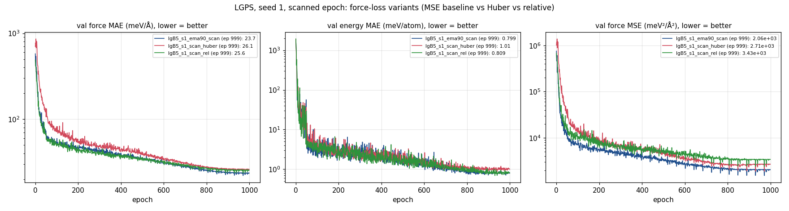
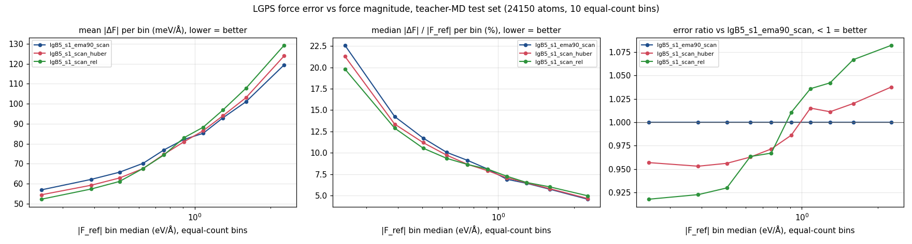

> **Note:** this study was carried out with Claude (Anthropic's AI assistant) under close human oversight.
> None of the conclusions here are final.

# Force-loss variants on LGPS: MSE vs Huber vs relative MSE

Does changing the force loss change *where* an apax GMNN student is accurate? Three runs on the LGPS bootstrap
(`../apax-lgps-bootstrap`) are identical except for the force loss: same data, model (packed-B5 GMNN, ELU output head),
seed 1, Muon, EMA 0.9, scanned epoch, 1000 epochs.

| run | force loss | weight |
|---|---|---|
| `lgB5_s1_ema90_scan` (baseline) | MSE | 4 |
| `lgB5_s1_scan_huber` | Huber, δ = 0.05 eV/Å | 8 (the quadratic core matches MSE at weight 4) |
| `lgB5_s1_scan_rel` | relative MSE, ((F_pred − F_ref) / (ε + \|F_ref,i\|))², ε = 0.1 eV/Å | 4 |

How the relative MSE works:
- \|F_ref,i\| is the atom's whole reference force vector magnitude, so all three components share one weight and the loss stays rotation-invariant.
- It is a weighted MSE with w_i = 1/(ε + \|F_i\|)². The weight is 44 at 0.05 eV/Å, 0.83 at 1 eV/Å and 0.10 at 3 eV/Å; ε caps it at 100.
- Implemented as `loss_type: relative_mse` (`patches/relative_mse_loss.diff`, against apax `model-and-perf-improvements` 8c0824f4 plus local changes; uncommitted).

## Results

**Validation (bootstrap frames, epoch 999):**

| | MSE | Huber | relative |
|---|---|---|---|
| force MAE (meV/Å) | 23.7 | 26.1 (+10 %) | ~ties MSE at matched epochs (28.9 vs ~29 at epoch 720) |
| force MSE (meV²/Ų) | 2,060 | 2,710 (+32 %) | ~1.7× MSE at matched epochs |
| energy MAE (meV/atom) | 0.80 | 1.01 (+26 %) | ~ties |

The MSE metric grows much more than the MAE for both alternative losses: the tail of large errors gets heavier.

**Error vs force magnitude on held-out teacher MD.** The test set is 600/900 K teacher MD, 483 frames and 24,150 atoms. Atoms are split into 10 equal-count bins of \|F_ref\|; the error is the per-atom vector norm \|ΔF\|.

| \|F_ref\| | Huber / MSE | relative / MSE |
|---|---|---|
| smallest 30 % (≲0.4 eV/Å) | **0.95** | **0.92** |
| middle (0.6–0.8 eV/Å) | 0.97 | 0.97 |
| crossover | ~1.0 eV/Å | ~0.9 eV/Å |
| largest 30 % (≳1.3 eV/Å) | 1.02–1.04 | **1.04–1.08** |
| mean \|ΔF\| over all atoms (meV/Å) | 80.7 vs 81.2 | 81.8 vs 81.2 |

Per element, mean \|ΔF\| in meV/Å:

| | MSE | Huber | relative |
|---|---|---|---|
| Li | 58.4 | 54.3 (−7 %) | **51.9 (−11 %)** |
| Ge | 131.9 | 149.6 (+13 %) | 138.5 (+5 %) |
| P | 138.8 | 141.8 (+2 %) | 145.9 (+5 %) |
| S | 86.5 | 86.8 | 91.2 (+5 %) |

## What it says

- **Both losses shift accuracy from large forces to small ones,** with a crossover near 1 eV/Å. The relative loss tilts about 2× harder than Huber: −8 % at the small-force end, +8 % at the large-force end. The overall mean barely moves, so this is a redistribution, not a free gain.
- **Physically, the soft, mobile Li atoms improve and the stiff GeS₄/PS₄ framework gets worse.** For Li transport that may be the right trade. It is untested: the next check is whether Ea and D(T) move toward the teacher.
- **Relative error per bin** runs from ~20 % on the smallest forces to ~5 % on the largest for all three losses. The losses only shave the small-force end (22.5 → 19.8 % in the lowest bin).
- **Huber** brings no benefit on validation here (clean data, no outliers to protect against) and learns more slowly at first.

## Caveats

- **One seed per loss.** The LGPS seed spread is ~6 % on overall metrics. The binned ratio curves are smooth and monotonic over 10 bins of ~2,400 atoms, so the *shape* is unlikely to be noise, but the overall levels are within noise.
- **The relative loss's weight is not normalised.** At weight 4 the effective force/energy balance differs from the baseline.
- **\|ΔF\| here is the vector norm,** roughly 1.6–2× the per-component MAE quoted in `../apax-lgps-bootstrap`.

## Next

- A second seed of the relative loss.
- ε = 0.3 (a gentler tilt).
- A weight normalised to mean effective weight ≈ 1.
- Ea / D(T) from student MD vs the teacher.
- The same analysis on superionic water, where the force scale is extreme and the errors already scale with \|F\|.

## Files

- `configs/`: the three training configs.
- `logs/`: `log.csv` per run, and `err_vs_force.txt` with the per-element and per-bin numbers.
- `scripts/`: `err_vs_force.py` (equal-count-bin analysis, CPU `batch_eval`) and `plot_losses_cmp.py`.
- `figs/`: the plots above.
- `patches/relative_mse_loss.diff`: the new loss type.
