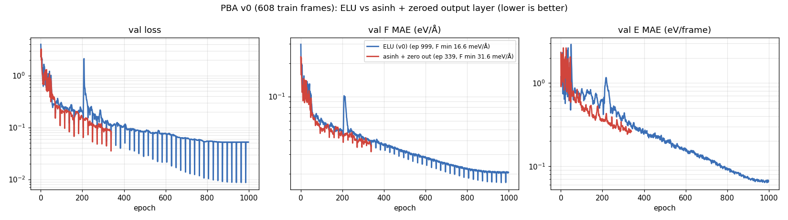

> **Note:** this study was carried out with Claude (Anthropic's AI assistant) under close human oversight.
> None of the conclusions here are final.

# K-Prussian blue (K_xFe[Fe(CN)₆]) from a PET-MAD-m bootstrap: apax GMNN stress test

A stiff covalent framework (Fe–C≡N–Fe) with a heavy, slow cation in open cages. Can a bootstrap-only apax student
reproduce the teacher? The target is PET-MAD-m, not experiment.

**Short answer so far: yes, for structure and stability.**
- **Accuracy:** val F MAE about 20 meV/Å, E about 1 meV/atom.
- **Stability:** MD is stable to 900 K on 512 atoms, with no bonds broken.
- **K mobility:** no K hops in 50 ps, as expected from the teacher's ~0.95 eV barrier. K mobility therefore has to be tested with NEB (pending).

## Teacher (`teacher_checks/`, `literature/`)

- **PET-MAD is not spin-polarised** (r2SCAN, no +U).
  - High-spin Fe–N comes out low-spin-like: 1.91 Å against 2.04–2.23 Å measured.
  - The lattice is 1.5–3 % small: the teacher cell is 9.86–9.91 Å.

  Accepted, since we test the student against the teacher.
- **K hop through the cage window:** about 0.95 eV (PET-MAD-m), against 0.87 eV in the DFT literature (`k_hop_neb.py`, `khop_*.json`).
- **Other checks:** the P2₁/n slide-and-tilt phase (`p21n_check.py`), the molecular HCN control and teacher-vs-teacher-size checks (s vs m).
- **Agent reports:** `literature/PBA_PLAN.md`, `structures_findings.md`, `observables_findings.md`.

## Data (`scripts/gen_pba*.py`; 64-atom cubic cells, Fe₄[Fe(CN)₆]₄ + 0–8 K)

- **v0:**
  - relaxed cells at K 0/2/4/6/8;
  - strains with rattles; random K arrangements; off-centre K; K hops (raw, and with the framework relaxed);
  - Fe(CN)₆ vacancies; CN flips; octahedral tilts; large rattles; volume scans;
  - a little zeolitic and coordinated water.
- **v0b:** scaled rattles. 138 kept; 78 dropped by the 30 eV/Å cut.
- **v1 blocks:** 104 frames:
  - P2₁/n slides;
  - K scans along ⟨100⟩/⟨110⟩/⟨111⟩;
  - rigid C≡N moves in place of isotropic C/N rattles (C≡N fluctuates only ~0.03 Å even at 900 K).
- **Split:** 608 train / 67 val. The test set is 464 frames of teacher MD (K8 and K4 at 300 and 600 K, 5 ps).

## Training (`configs/`, `logs/`; r_max 6, Muon, scanned epoch)

End-of-training values (epoch 999). The "best" values, 16.6 and 15.8 meV/Å at epoch 964, are dips from the validation bug below.

| model | val F MAE (meV/Å) | val E MAE (eV/frame, ~64–72 atoms) | vs ELU |
|---|---|---|---|
| `pba_v0_s1` (ELU output) | 20.5 | 0.066 | 1× |
| `pba_v0_asinh` (asinh + zero-init output layer) | **19.8** | 0.070 | F 3 % better, E 6 % worse (1 seed: noise) |

The two output heads are equivalent here. The fix only matters on dense systems (see `../apax-superionic-water`).

**Validation bug found here:**
- apax computes `steps_per_epoch = n_data // batch_size` and reuses it for validation, and the val iterator carries on across epochs.
- With 67 val frames and batch 8, 3 frames drop each epoch in a sliding window. That makes the periodic val-loss dips every ~22 epochs, and best-checkpoint selection is optimistic.
- Not yet fixed.

## Student MD (v0, 50 ps NVT, 512-atom 2×2×2 cells; six runs in 25 minutes)

| run | T (K) | Epot drift (meV/atom) | closest C–N / Fe–C (Å) | bonds broken | D_K (cm²/s) |
|---|---|---|---|---|---|
| K8 300 K | 299 ± 11 | −1.1 | 1.11 / 1.74 | 0 | noise |
| K8 600 K | 599 ± 22 | −9.5 | 1.10 / 1.70 | 0 | noise |
| K8 900 K | 900 ± 34 | +0.6 | 1.08 / 1.64 | 0 | 2e-10 |
| K4 300 K | 300 ± 12 | +2.6 | 1.11 / 1.73 | 0 | noise |
| K4 600 K | 598 ± 22 | +1.9 | 1.09 / 1.70 | 0 | 1.7e-8 |

## Active learning, cycle 1

- **Sampling:** 12 student runs on training-size cells (300–1200 K), 96 frames each, 9.3 ms/step.
- **Labelling:** the first pass was lost to a timeout because the script wrote only at the end. Labelling now writes frame by frame and resumes. Requeued; not yet labelled.

## Pending

- Student vs teacher K-hop NEB.
- Active-learning error analysis.
- v1 retrain.
- Learning curves and capacity sweep.
- Full-pass validation.
- 3 seeds.
