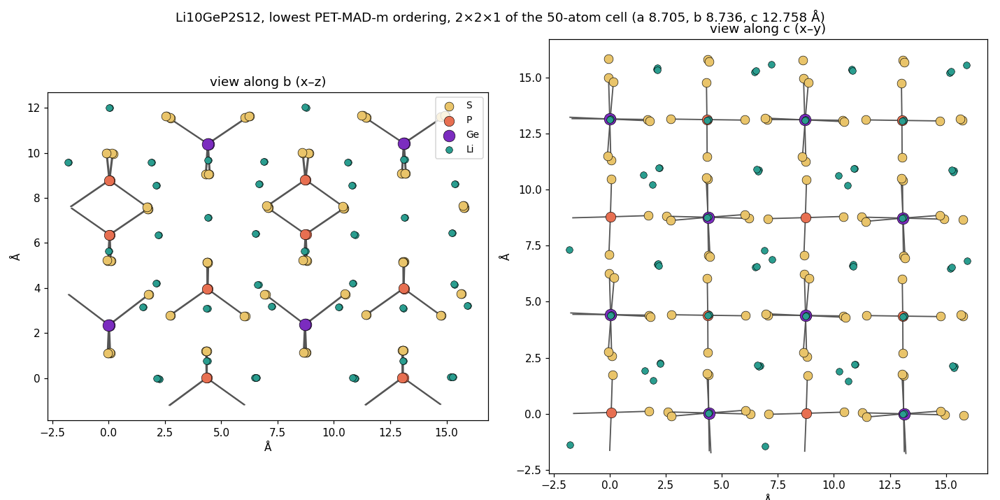
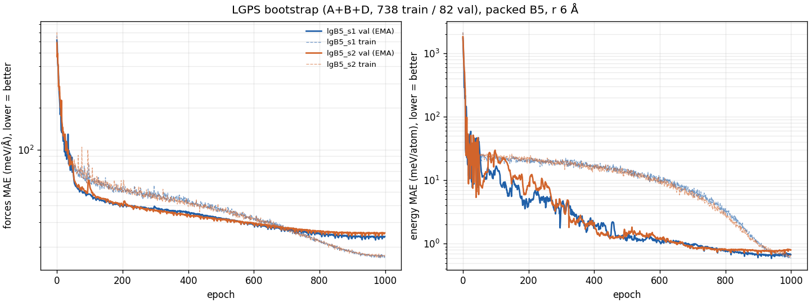
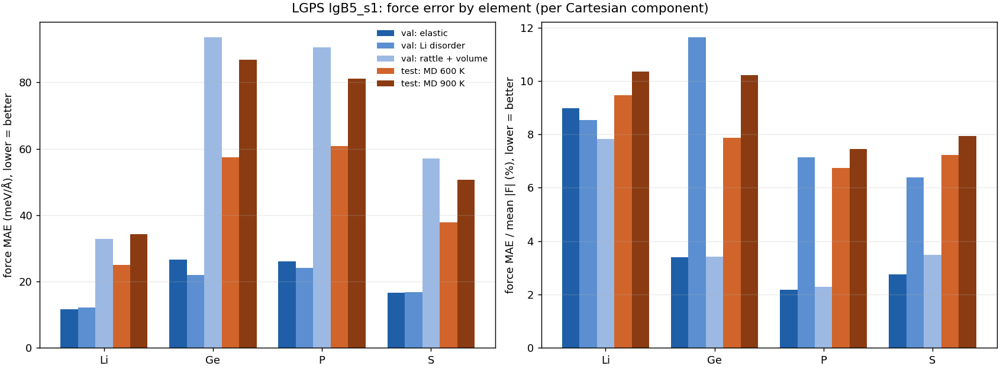
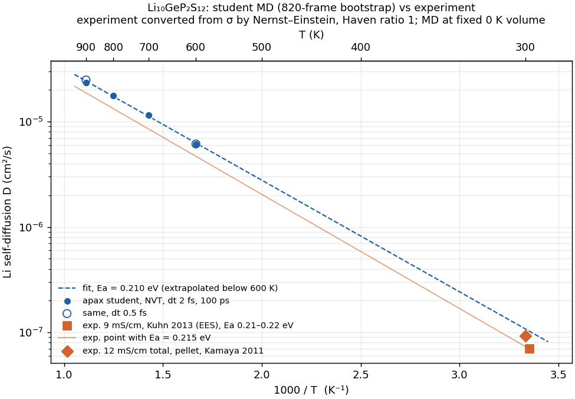
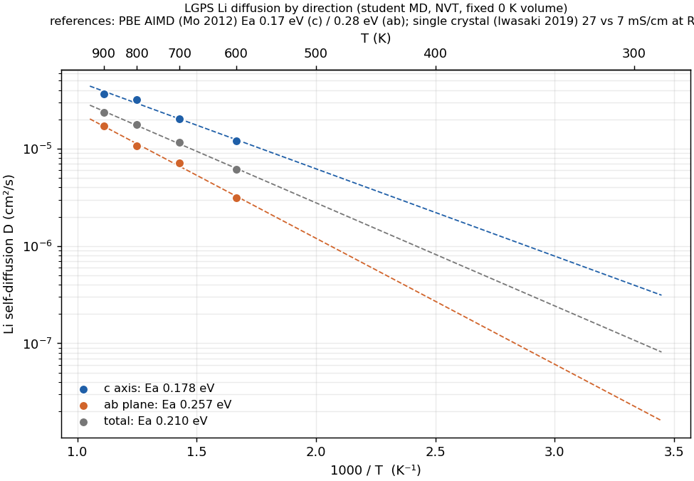

> **Note:** this study was carried out with Claude (Anthropic's AI assistant) under close human oversight.
> None of the conclusions here are final.

# LGPS (Li₁₀GeP₂S₁₂) from an 820-frame teacher-labelled bootstrap: apax GMNN stress test

Can a small, MD-free bootstrap set, labelled by a foundation model, train an apax GMNN good enough for stable MD and correct Li transport in a superionic conductor? LGPS mixes very stiff bonds (P–S and Ge–S tetrahedra) with a soft, mobile Li sublattice.

**Short answer so far: yes, in NVT.**
- **Stability:** 100 ps at 600–900 K on 400 atoms. No holes, no broken tetrahedra.
- **Transport:** Li diffusion is Arrhenius with Ea = 0.210 eV. That matches PFG-NMR (0.21(1) eV) and PBE AIMD (0.21 eV).
- **Anisotropy:** reproduces the AIMD split (0.18 eV along c vs 0.26 eV in ab).
- **Not yet done:** NPT runs and the finite-size checks are still in progress (see Caveats).

## Requirements

- **apax:** branch `model-and-perf-improvements` of [github.com/Chronum94/apax](https://github.com/Chronum94/apax/tree/model-and-perf-improvements).
  - Training and the first MD runs used `3c1f1c6d`.
  - The `scan_epoch` run used `8c0824f4`, which adds the scanned epoch.
- **Teacher:** PET-MAD v1.6 (r2SCAN; sizes xs/s/m from lab-cosmo/upet), run through [pet-jax](https://pypi.org/project/pet-jax/) 0.1.0.
  - Screening used PET-MAD-s. All labels and relaxations used PET-MAD-m.
  - pet-jax runs on the GPU in the same ROCm container as apax (JAX 0.10.0). pet-jax, marathon-train and opsis were installed with `--no-deps`.
  - PET-MAD-m: 33 ms per 50-atom call and 74 ms per 200-atom call on the GPU, against about 0.9 s per 64 atoms on 16 CPU threads.
- **Hardware:** AMD RX 9070 XT, ROCm in podman on WSL2. `XLA_FLAGS=--xla_gpu_enable_command_buffer=`.
- **Paths:** the scripts use paths local to the machine the study ran on.

## Structure

- **Source:** COD 7215191 (Kuhn, Köhler, Lotsch, PCCP 15, 11620 (2013); single crystal at 298 K, P4₂/nmc, a = 8.719, c = 12.639 Å).
  - Ge/P share the 4d sites 50/50.
  - 32 Li sites (16h 0.466, 4d 0.86, 8f 0.74, 4c 0.81) hold 20.06 Li per cell.
  - `scripts/sites.py` expands the sites.
- **Ordered 50-atom cells (Li₂₀Ge₂P₄S₂₄):** 6 Ge/P arrangements × 200 Li orderings (20 of 32 sites, no Li–Li pair under 1.8 Å, sampled by occupancy) were screened with PET-MAD-s (`order.py`). The 8 lowest, plus the best of the missing Ge arrangement, were relaxed with PET-MAD-m (positions and cell; `relax.py`, `gen_boot.py`). They are in `data/relaxed_all.extxyz`.
- **Lowest ordering:** a / b / c = 8.705 / 8.736 / 12.758 Å, V = 970.1 ų. That's +1.0 % against experiment at 298 K and +3.0 % against 100 K. The next ordering is 0.32 eV (6 meV/atom) higher. P–S is 2.05 Å, Ge–S 2.23 Å, the closest Li–Li 3.15 Å.

## Bootstrap set (`gen_boot.py`): 820 frames, 41k atoms, no MD

| block | content | n | E above lowest, median / max (meV/atom) | max\|F\|, median / max (eV/Å) |
|---|---|---|---|---|
| A elastic | 9 relaxed orderings × 11 strains (isotropic ±2 and ±4 %; a, c ±3 %; shear ±2 %) × rattle 0.03 / 0.07 Å | 198 | 50 / 175 | 3.0 / 15.5 |
| B Li disorder | 50 Li orderings per Ge arrangement, all 6 arrangements; 20 fixed-cell FIRE steps | 300 | 30 / 67 | 0.4 / 0.8 |
| B starts | about a third of the B starting structures, unrelaxed | 88 | 89 / 146 | 1.8 / 3.1 |
| D large rattle | relaxed and B structures, rattle 0.10–0.25 Å | 119 | 273 / 1080 | 11.8 / 29.5 |
| D volume | V/V₀ 0.80–1.15 × rattle 0.05 / 0.15 Å | 115 | 193 / 751 | 6.1 / 27.3 |

- **Drops:** frames with max|F| > 30 eV/Å were removed, 60 in all (mostly 0.20–0.25 Å rattles).
- **Split:** random 738 train / 82 val. Labelling took about 6 minutes on the GPU.
- **Test set:** PET-MAD-m Langevin MD at 600 and 900 K on 50-atom cells, 5 ps each, frames every 25 fs after the first 1 ps (`md_teacher.py`). 483 frames from three runs. A fourth run (the Ge (2,3) ordering at 900 K) stopped with a pet-jax neighbour-selection overflow (`cannot recover from overflow after retry (k_sel=47)`).

## Model and training (`configs/`)

- **Model:** GMNN, packed moments, A = 12, B = 5, 12 Bessel functions, r_max 6 Å, NLH repulsion (r_max 6, fixed coefficients), readout [128, 128], per-element regression shift.
- **Training:** Muon (lr 0.02, wd 0.01), batch 4, 1000 epochs with one cosine period. Loss: E 1, F 4, stress 0.2. EMA from epoch 50 (decay per step).

| run | EMA decay | loop | epoch 0 (s) | median epoch (s) | total (min) | val F (meV/Å) | val E (meV/atom) |
|---|---|---|---|---|---|---|---|
| lgB5_s1 | 0.999 | step loop | 58.8 | 2.05 | 35.7 | 23.8 | 0.67 |
| lgB5_s2 | 0.999 | step loop | 15.5 (persistent-cache hit) | 2.10 | 36.5 | 25.2 | 0.80 |
| lgB5_s1_ema90_scan | 0.9 | `scan_epoch` | 304.9 | **0.90** | **20.6** | 23.7 | 0.80 |

- **`scan_epoch: true`:** the training set lives on the device and each epoch is one `lax.scan`, so per-epoch time is 2.27× faster. The cost is a 5.2× longer first compile.
- **Accuracy is unchanged** within seed noise. That run also differs in EMA decay and shuffle order.

**Test errors** (meV/atom, meV/Å; `eval_test.py`):

| set | s1 E | s1 F | s2 E | s2 F | scan E | scan F |
|---|---|---|---|---|---|---|
| val, elastic | 0.28 | 15.8 | 0.31 | 17.2 | 0.28 | 15.4 |
| val, Li disorder | 0.65 | 12.1 | 0.67 | 13.0 | 0.87 | 11.6 |
| val, volume scan | 1.09 | 39.6 | 1.09 | 41.9 | 1.19 | 40.4 |
| val, large rattle | 1.09 | 66.4 | 2.48 | 71.2 | 2.18 | 69.3 |
| **teacher MD, 600 K** | 0.84 | **35.3** | 0.87 | 36.8 | 1.00 | 36.1 |
| **teacher MD, 900 K** | 1.38 | **48.0** | 1.37 | 49.7 | 1.38 | 49.4 |

Thermal frames are 2–3× harder than near-equilibrium bootstrap frames, but energies stay at about 1 meV/atom.

**Force error by element** (lgB5_s1; `scripts/eval_elements.py`; values read off the plot):

| element | teacher MD 600 / 900 K (meV/Å) | relative to mean \|F\| |
|---|---|---|
| Li | 25 / 34 | 9.5 / 10.4 % |
| Ge | 58 / 87 | 7.9 / 10.2 % |
| P | 61 / 81 | 6.7 / 7.4 % |
| S | 38 / 51 | 7.2 / 7.9 % |

- **Absolute errors** are highest on the stiff Ge and P.
- **Relative to their own forces,** every element sits at 7–10 %, and Li is no worse than the framework. Superionic water shows the same thing: errors scale with |F|.
- **Bootstrap val frames:** the rattle-and-volume block dominates the absolute errors, while the Li-disorder block has the highest relative error for Ge, P and S.

## MD (apax jax-md, 2×2×2 cell, 400 atoms, lowest ordering, fixed 0 K volume unless stated)

**Stability:**
- NVT (Nosé–Hoover chain, τ 100 fs) at 600–900 K, 100 ps, dt 0.5 and 2 fs: no failures.
- Every P has 4 S at all times. The closest pair of any kind is 1.83 Å; the closest Li–Li is 2.04 Å (training reaches 2.20 Å).
- At 900 K, GeS₄ occasionally stretches one Ge–S bond to 2.6–2.9 Å (equilibrium 2.23 Å), in 0.8 % of Ge-frames, but never loses an S. The teacher's 5 ps at 900 K reaches 2.63 Å in 0.3 %. That's mild extra softness, partly from the ~1.8 GPa of compression in the fixed-volume runs.
- NVE at 2 fs (equilibrated to about 300 K): drift < 1e-4 meV/atom/ps, fluctuation 0.006 meV/atom.

**Timestep:** 2 fs gives the same D as 0.5 fs (600 K: 6.12 vs 6.14 × 10⁻⁶; 900 K: 2.36 vs 2.49 × 10⁻⁵ cm²/s) and is 3.4× faster (68 vs 20 ns/day).
- **Velocity criterion:** P(Li moves > 0.1 Å in one step) < 10⁻⁵ under a Maxwell distribution, i.e. dt ≤ 0.1 Å / `maxwell.ppf(1 − 1e-5, scale=sqrt(kT/m_Li))`.
- **Bound by temperature:** 3.3 fs at 300 K, 2.3 fs at 600 K, 1.9 fs at 900 K. So 2 fs is about 6 % over the bound at 900 K.

**Li diffusion** (NVT, dt 2 fs, 100 ps; `plot_arrhenius.py`, `plot_aniso.py`; MSD over many time origins after the first 10 %):

| T (K) | D total (cm²/s) | D along c (cm²/s) | D in ab, per axis (cm²/s) | c / ab |
|---|---|---|---|---|
| 600 | 6.12e-6 | 1.21e-5 | 3.13e-6 | 3.9 |
| 700 | 1.16e-5 | 2.04e-5 | 7.18e-6 | 2.8 |
| 800 | 1.77e-5 | 3.18e-5 | 1.07e-5 | 3.0 |
| 900 | 2.36e-5 | 3.66e-5 | 1.71e-5 | 2.1 |

| | Ea total (eV) | Ea along c (eV) | Ea in ab (eV) | σ(300 K) (mS/cm) |
|---|---|---|---|---|
| **this work** (extrapolated; Nernst–Einstein, Haven ratio 1) | **0.210** (0.194–0.220 dropping one T) | **0.178** | **0.257** | 13.7 |
| PBE AIMD, Mo 2012 (SIM) | 0.21 | 0.17 | 0.28 | 9 (range 2–40) |
| PFG-NMR, Kuhn 2013 EES (EXP, powder) | 0.21(1) | – | – | – |
| impedance, Kuhn 2013 EES (EXP, pellet) | 0.22(2) bulk | – | – | 9 (total) |
| Kamaya 2011 (EXP, pellet) | 0.24 (quoted by others) | – | – | 12 (total) |
| single crystal, Iwasaki 2019 (EXP) | – | ~0.3 | ~0.3 | 27 along [001], 7 along [110] |

`literature.md` lists sources and what was and wasn't verified. It was compiled by a search agent that used no logins or emails; paywalled items are listed as unverified.

## Caveats

- **Fixed volume.** The NVT runs use the 0 K PET-MAD-m cell. At 600 and 900 K that means about 1.1 and 1.8 GPa (virial + kinetic, assuming apax's positive-compressive convention). NPT (isotropic Nosé–Hoover, 1 bar, 100–900 K, 1 ns at 300–500 K) is running; see Pending.
- **Finite size.** Huang et al. (arXiv:2006.03320, DP-PBE) found that a 200-atom 2×2×1 cell overestimates D at 300 K by 10–100×. Our 400-atom cell is untested for size effects, and the 300 K extrapolation should not be trusted until a large cell (~3,000 atoms) has been checked.
- **Anisotropy against experiment.** We reproduce AIMD's c/ab split. PFG-NMR, however, saw no ultrafast D_c, and its D matches the AIMD ab extrapolation, while the single crystal gives only about 4× anisotropy at room temperature. Extrapolated to 300 K our ratio is about 17, but that rests on 4 points at 600–900 K.
- **Teacher vs experiment.** The student learns PET-MAD-m (r2SCAN), so agreement with experiment mixes teacher and student error. A teacher MD reference at one temperature is still to do.
- **Ordering.** All MD starts from the single lowest Li/Ge ordering. Qi 2024 reports Ea from 0.09 to 0.22 eV across orderings.
- **Statistics.** One model and one 100 ps run per temperature. Seed noise in the static errors is small (s1 vs s2 within 6 %).

## Pending / next

- **NPT:** volume vs the COD 100 and 298 K cells (thermal expansion about 3.4 × 10⁻⁵ K⁻¹, secondary source); Li site occupancies at 300 K vs Kuhn (0.466 / 0.86 / 0.74 / 0.81); Arrhenius and anisotropy at the right density.
- **Large cell** (~3,200 atoms) at 400–600 K for finite-size effects.
- **Teacher (PET-MAD-m) labels on student MD frames** (direct hole test); **teacher MD** for D at 900 K.
- **Seed spread of Ea** (s2, ema90_scan); **dt 3 fs at 300 K** against 2 fs.
- **Heating to decomposition** (Weber 2016 reports partial decomposition to Li₄P₂S₆); other orderings and off-stoichiometric Li₁₀₊ₓGe₁₊ₓP₂₋ₓS₁₂.

## Files

- **`scripts/`:**
  - structure and ordering: `sites.py`, `order.py`, `relax.py`;
  - bootstrap and teacher test MD: `gen_boot.py`, `md_teacher.py`;
  - split and plots: `split.py`, `show_cell.py`, `plot_loss.py`;
  - evaluation and MD analysis: `eval_test.py` + `cpuload.py`, `eval_elements.py`, `analyze_md.py`, `analyze_npt.py`, `plot_arrhenius.py`, `plot_aniso.py`;
  - GPU queues: `boot.sh`, `queue*.sh`;
  - apax MD in the container: `md.sh` + `rocm_argsort_patch.py`.
- **`configs/`:** training configs. `lgB5_s1_ema99` was queued but not run yet.
- **`md_templates/`:** NVT, NVE and NPT input templates.
- **`logs/`:** training `log.csv` per run.
- **`data/relaxed_all.extxyz`:** the 9 relaxed ordered cells, with PET-MAD-m energies, forces and stress. The bootstrap set itself (4.9 MB) is not included; `gen_boot.py` regenerates it from these and `cand_s.extxyz` (from `order.py`, seed 0).
- **`figs/`:** cell, loss curves, Arrhenius plots.
- **`literature.md`:** reference values with sources and verification status.
