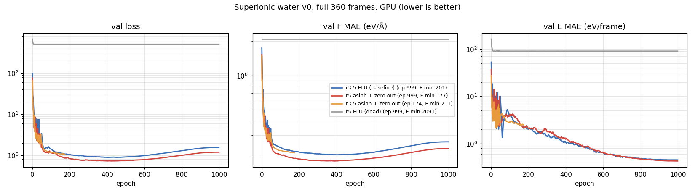

> **Note:** this study was carried out with Claude (Anthropic's AI assistant) under close human oversight.
> None of the conclusions here are final.

# Superionic water (2–4.6 g/cm³) from a PET-MAD-m bootstrap: apax GMNN stress test

Can an apax GMNN student learn PET-MAD-m on dense, hot water (ice VII/X, bcc and fcc superionic, up to ~380 GPa) well
enough for superionic MD? The target is the teacher, not experiment.

**Short answer so far:**
- **Yes, at r_max 3.5.** That student gives superionic MD with D_H within ~15 % of Cheng 2021. It collapses at 4500 K.
- **The same config dies silently at r_max 5.** The cause is the bounded ELU output head, which is our own local change (see "Readout death").
- **Fixed with a zeroed output layer.** The fixed r_max 5 student is the best so far.
- **Data, not settings, is the limit now.** With 360 frames every model overfits after ~400 epochs. A ~7× larger set from student MD is queued (v1).

## Requirements

- **apax:** branch `model-and-perf-improvements` (`8c0824f4`, scanned epoch).
  - The output-head fix is `patches/signed-log-readout.diff` against that commit, uncommitted on a local branch.
  - `patches/test_readout_output.py` is its unit test.
- **Teacher:** PET-MAD-m (v1.6, r2SCAN) through pet-jax 0.1.0 on the GPU (`bucket_strategy="powers_of_2"`).
- **Hardware:** AMD RX 9070 XT, ROCm in podman on WSL2. The scripts use paths on the machine the study ran on.

## Teacher credibility (`literature/`, `teacher_checks/`)

A literature agent's report (`literature/SICE_PLAN.md`, `lit_eos_teacher.md`, `lit_phase.md`) gave us:
- **Usable range:** PET-MAD-m is usable from ~15 to ~350 GPa. Frames above 4.6 g/cm³ are dropped.
- **PET is not exactly rotation-invariant,** and the spread grows with compression (`rotcheck.py`, `symcheck.py`). All labels use PET-MAD-m.

Bootstrap pressures (teacher stress, cold or relaxed frames) against Millot 2019, which was measured at 1900–2300 K:

| ρ (g/cm³) | teacher P median (GPa) | Millot 2019 |
|---|---|---|
| 2.0 | 6 | |
| 3.0 | 74 | 3.07 g/cm³ at 101 GPa |
| 4.0 | 249 | 3.89 g/cm³ at 278 GPa |
| 4.5 | 378 | |

So the teacher is ~15–20 % soft at Millot's densities, partly because our frames are cold.

**Teacher cost at these densities:**
- **MD:** about 2.4 ms per atom-step, against ~0.7 ms at 50-atom ambient densities. That's 385 ms/step for 162 atoms and 183 ms/step for 96.
- **Test sets:** three teacher MD runs, 151 frames each (bcc ρ 3.0 at 2000 and 3000 K, fcc ρ 4.0 at 3000 K). Each took 25–50 minutes.

## Data (`scripts/gen_sice.py`)

v0 bootstrap, no MD frames:
- **Starting structures:**
  - ice VII (ice rules) and ice X;
  - bcc O (54 H₂O) and fcc O (32 H₂O) with random tetrahedral/octahedral H;
  - all-tetrahedral fcc;
  - the bcc→fcc Bain path;
  - molecular-random and liquid-like frames.
- **Rattles:** O and H are rattled separately.
- **Size:** 457 frames at ρ 2.0–5.0. After dropping ρ > 4.6 and max|F| > 20 eV/Å: 360 train / 40 val.
- **Frame sizes:** 48, 96 or 162 atoms (mean 121), about 130k force components in all.

## Readout death at r_max 5 (the main finding)

**Symptom:** at r_max 5 (~180–200 neighbours per atom) the val force MAE is constant to 5 decimals from epoch 1. Energy improves only through the per-element shift. Gradients are finite (a probe with zeroed NaNs showed normal-sized updates).

**Mechanism (measured):**
- The per-atom energy is `scale · elu(o) + shift`, and elu ≥ −1.
- Low-density frames need energies 0.8–1.4 eV/atom below the shift, which is more than `scale` can reach.
- So training drives the output pre-activation o to about −476, where elu′ ≈ 1e-36 and every upstream gradient is zero.
- The raw descriptor inflating to rms 65 (0.29 when healthy) makes the runaway fast. GMNN moments are unnormalised sums over neighbours, and contractions multiply 2–3 of them.
- The ELU output head is our own local change. Upstream GMNN uses a linear output.

**Training knobs that did not help** (16 frames, 40 epochs, CPU; dead = 1.863 eV/Å):

| r_max 5 variant | val F MAE ep 39 (eV/Å) | vs r_max 3.5 ref |
|---|---|---|
| default (elementwise clip 1000) | 1.863 (dead) | 1.77× worse |
| clip 0.01 | 1.854 | 1.76× worse |
| clip 0.001 | 1.744 | 1.66× worse |
| Muon LR 1e-3 | 1.861 (dead) | 1.77× worse |
| 10 / 20-epoch LR warmup | 1.863 (dead) | 1.77× worse |
| **r_max 3.5, ELU (reference)** | **1.052** | 1× |

Loss weights, Huber, per-atom energy loss, biases, NTK, Muon LR 2e-3 and a swish readout were also tried; all died or stalled.

**Fixes tried** (same 16-frame test):

| output head | val F MAE (eV/Å) | vs dead ELU |
|---|---|---|
| **linear (identity) + zero-init output layer** | **0.839** | 2.2× better |
| asinh + zero-init output layer | 0.873 | 2.1× better |
| asinh, random init | 0.917 | 2.0× better |
| sign(x)·log1p\|x\|, random init | 0.968 | 1.9× better |
| linear, random init | 0.975 | 1.9× better |
| ELU + zero-init | 1.100 | 1.7× better |
| ELU (current) | 1.863 (dead) | 1× |

Notes on the fixes:
- **sign·log1p:** has zero JAX gradient at exactly 0, so with a zeroed output layer it never trains; asinh replaces it.
- **Zero-init scope:** only the output layer is zeroed. Zeroing the whole readout is dead by symmetry.
- **Neighbour-count normalisation was dropped.** Dividing the moments by the average count shrinks the descriptor to rms ~0.015 (contractions go as 1/N² to 1/N³), and learning slows.
- **Recommendation:** a linear output plus `zero_init_output: true`. asinh ties with it, with no shown advantage (one seed).

## Full training runs (360 frames; `configs/`, `logs/`)

| model | best val F (meV/Å) | at epoch | end (ep 999) | vs r_max 3.5 ELU |
|---|---|---|---|---|
| r_max 5, ELU (`sice_v0_s1_nangrad`) | 2091 (dead) | – | 2091 | 10.4× worse |
| r_max 3.5, ELU (`sice_v0_s1`) | 201 | ~400 | 261 | 1× |
| r_max 3.5, asinh + zero (`sice_v0_slog_r3`) | 202 | 412 (killed) | – | 1.00× |
| **r_max 5, asinh + zero (`sice_v0_slog_r5`)** | **177** | ~390 | 228 | **12 % better** |

- **The cutoff is the gain.** With the head held fixed, r_max 3.5 vs 5 is 202 vs 177.
- **All runs overfit after ~400 epochs.** Train F MSE drops 4× from epoch 400 to 999 while val F MSE rises 1.8×; val energy keeps improving (0.45 eV/frame at ep 999 for r_max 3.5).
- **Errors scale with |F|.** O errors are ~1.7× H errors, but relative errors are the same (8–9 %), so this is not an O-needs-a-longer-cutoff effect.
- **Loss:** E 1, F 4, stress 0.2 (MSE); batch 4; Muon; `scan_epoch: true`.

**Errors on teacher MD frames** (r_max 3.5 ELU student):

| teacher run | F MAE (meV/Å) | H / O | F rms (eV/Å) | relative | E MAE (meV/atom) |
|---|---|---|---|---|---|
| bcc 3.0, 2000 K | 166 | 140 / 220 | 1.99 | 8.4 % | 2.2 |
| bcc 3.0, 3000 K | 213 | 175 / 289 | 2.49 | 8.6 % | 3.2 |
| fcc 4.0, 3000 K | 205 | 162 / 289 | 2.73 | 7.5 % | 11.1 |

## Student MD (r_max 3.5 ELU; 10 ps NVT; 1296 atoms bcc ρ 3.0, 768 atoms fcc ρ 4.0)

| run | D_H (cm²/s) | D_O | closest H–H / O–O (Å) | verdict |
|---|---|---|---|---|
| bcc 1500 K | 1.2e-6 | – | 1.01 / 1.90 | ice |
| bcc 2000 K | 2.0e-5 | – | 1.01 / 1.83 | onset |
| bcc 2500 K | 4.1e-4 | – | 0.82 / 1.81 | superionic |
| bcc 3000 K | **6.0e-4** (Cheng 2021: 6.98e-4, 0.86×) | – | 0.72 / 1.70 | superionic |
| bcc 3500 K | 7.8e-4 | – | 0.68 / 1.72 | superionic |
| fcc 3000 K | **6.2e-4** (Cheng 2021: 7.4e-4, 0.84×) | – | 0.71 / 1.70 | superionic |
| fcc 4000 K | 1.0e-3 | 5e-8 | 0.66 / 1.63 | superionic, tight |
| fcc 4500 K | 2.1e-3 | 2.6e-4 | **0.32 / 0.99** | **collapsed (extrapolation)** |

- **Cheng comparison:** not matched state points; our runs are at fixed density, not Cheng's pressure.
- **Collapse:** the hottest training frames are at 3000 K, so above that the student is extrapolating.
- **Speed:** 1296 atoms × 40k steps took about 3 minutes (3.3 µs/step/atom).

## What we learned

1. A bounded output activation can kill training silently when the energy range below the shift exceeds `scale`. Watch the output pre-activation when force metrics are flat.
2. The cutoff matters for dense water (12 % at r_max 5 vs 3.5), but it costs ~2.9× the pairs.
3. With 360 frames the student is data-limited. Settings tuned on typical systems were not re-optimised here; the descriptor's growth with neighbour count is the most likely thing to be off.
4. A relative-force loss (errors scale with |F|) is parked as an idea.

## Pending

- **v1** (`configs/sice_v1_slog_r5.yaml`, same config, 500 epochs):
  - 97 short student runs (800–6000 K, every v0 structure type and density);
  - about 2300 teacher-labelled frames;
  - retrain.

  It was blocked when the GPU dropped out of WSL after a host driver update.
- Teacher MD at fcc 4000 K; active learning above 4500 K; seeds.
- A full-pass validation fix: apax drops `n_val mod batch` frames per epoch with a sliding window. That doesn't affect water (40/8), but it does affect PBA.
- Phase-diagram survey (D_H, D_O and O-lattice order on a P×T grid) once MD is stable above 4500 K.

## Files

- **`scripts/`:** bootstrap generators and start-frame picker.
- **`configs/`, `logs/`:** every training run above.
- **`figs/`:** loss curves; teacher EOS.
- **`teacher_checks/`:** rotation and symmetry checks, teacher EOS and teacher MD.
- **`literature/`:** agent reports.
- **`patches/`:** the output-head fix and its test.
- Shared tools (labelling, sampling, queue, guards) are in `../apax-teacher-student-tools/`.
